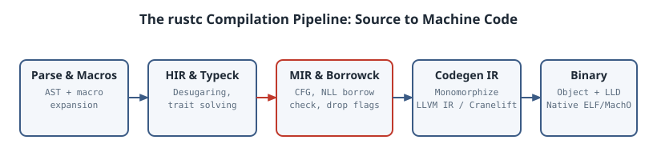

# The Rust Compilation Pipeline

Knowing how `rustc` transforms source code into native machine instructions demystifies compiler error messages, build-time bottlenecks, and why Rust's borrow checker is far smarter than early lexical analyzers. Rather than jumping straight from syntax trees to LLVM IR, `rustc` lowers code through three distinct intermediate representations.



## Stage-by-Stage Lowering

1. **Parsing & Macro Expansion (AST):** Source files tokenize and parse into an Abstract Syntax Tree. Declarative (`macro_rules!`) and procedural (`#[derive(...)]`) macros expand here before type checking begins.
2. **HIR (High-Level Intermediate Representation):** Desugars ergonomic syntax (`for` loops, `if let`, `async fn`, `?` operator) into explicit core constructs, resolves names, performs Hindley-Milner type inference, and checks trait bounds.
3. **MIR (Mid-Level Intermediate Representation):** Lowers HIR into a pure Control-Flow Graph (CFG) of basic blocks. **Non-Lexical Lifetimes (NLL) borrow checking**, move/drop-flag analysis, and Rust-specific optimizations (like enum niche layout optimization) all run on MIR.
4. **Codegen Backend (LLVM or Cranelift):** Monomorphizes generic functions into concrete machine types, emits LLVM IR (or Cranelift IR for fast debug builds), applies vectorization/inlining, and links object files into the final binary.

## Practical Build-Time Levers

| Lever | Where to Configure | Effect |
| :--- | :--- | :--- |
| `codegen-units = 16` (debug) / `1` (release) | `Cargo.toml` `[profile.*]` | More units compile in parallel; `1` maximizes cross-module LLVM optimization |
| `lto = "thin"` | `Cargo.toml` `[profile.release]` | Cross-crate inlining with modest link-time overhead |
| Fast linker (`mold` or `lld`) | `.cargo/config.toml` | Cuts incremental link latency by 3x–10x on large binaries |
| `cargo check` | CLI | Stops after HIR/MIR borrowck, skipping LLVM codegen completely |

> [!TIP]
> When diagnosing why a release binary is bloated or why a generic function isn't inlining, inspect MIR or LLVM IR directly—never guess from source syntax alone.

## Hands-On Lab: Emit and Inspect HIR, MIR, and LLVM IR

Compile a tiny function and ask `rustc` to dump its lowered MIR and optimized LLVM IR:

```bash
cat > /tmp/pipe.rs <<'RS'
pub fn sum_slice(xs: &[u64]) -> u64 {
    xs.iter().copied().sum()
}
RS

# 1. Inspect MIR basic blocks (where the borrow checker runs)
rustc --crate-type=lib --emit=mir -O /tmp/pipe.rs -o /tmp/pipe.mir
head -n 30 /tmp/pipe.mir

# 2. Inspect optimized LLVM IR (observe bounds-check elimination & SIMD)
rustc --crate-type=lib --emit=llvm-ir -O /tmp/pipe.rs -o /tmp/pipe.ll
grep -E 'define|vector|add ' /tmp/pipe.ll | head -n 20
```
