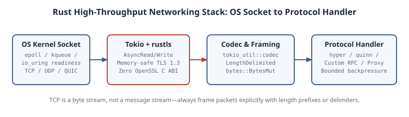

# TCP, UDP, and Binary Framing in Rust

Systems networking in Rust combines zero-overhead socket control with compile-time memory safety. Whether you are building a custom binary RPC protocol, a Redis-compatible server, or a telemetry ingest daemon, you face the same foundational constraint: **TCP is a continuous stream of bytes, never a stream of discrete messages**. Calling `read()` once may return half a packet, or three packets concatenated together.



## Framing Strategies Compared

| Strategy | Wire Format | Pros | Cons |
| :--- | :--- | :--- | :--- |
| **Length-prefixed** | `[4-byte big-endian len][payload]` | Binary-safe, O(1) allocation, zero escaping | Must enforce a strict `max_frame_length` cap to prevent OOM |
| **Delimiter-based** | `[payload][\r\n]` (RESP, HTTP/1.1, JSONL) | Human-readable, easy to debug with `nc` | Requires escaping or forbidding delimiter bytes inside payloads |
| **Fixed-size frames** | Exact N-byte structs | Zero header parsing overhead | Wastes bandwidth on variable-length payloads |

## Async Length-Prefixed Server with Tokio

Using `tokio::net::TcpListener` with `AsyncReadExt` / `AsyncWriteExt`, every connection runs inside a lightweight task while sharing a bounded semaphore for backpressure:

```rust
use std::io;
use std::sync::Arc;
use tokio::io::{AsyncReadExt, AsyncWriteExt};
use tokio::net::{TcpListener, TcpStream};
use tokio::sync::Semaphore;

const MAX_FRAME_LEN: usize = 64 * 1024; // 64 KiB cap prevents OOM attacks

async fn read_frame(stream: &mut TcpStream) -> io::Result<Option<Vec<u8>>> {
    let mut len_buf = [0u8; 4];
    match stream.read_exact(&mut len_buf).await {
        Ok(_) => {}
        Err(e) if e.kind() == io::ErrorKind::UnexpectedEof => return Ok(None),
        Err(e) => return Err(e),
    }
    let len = u32::from_be_bytes(len_buf) as usize;
    if len > MAX_FRAME_LEN {
        return Err(io::Error::new(io::ErrorKind::InvalidData, "frame exceeds limit"));
    }
    let mut payload = vec![0u8; len];
    stream.read_exact(&mut payload).await?;
    Ok(Some(payload))
}

async fn write_frame(stream: &mut TcpStream, payload: &[u8]) -> io::Result<()> {
    let len = u32::try_from(payload.len())
        .map_err(|_| io::Error::new(io::ErrorKind::InvalidInput, "frame too large"))?;
    stream.write_all(&len.to_be_bytes()).await?;
    stream.write_all(payload).await?;
    stream.flush().await
}

pub async fn run_server(addr: &str, max_conns: usize) -> io::Result<()> {
    let listener = TcpListener::bind(addr).await?;
    let permits = Arc::new(Semaphore::new(max_conns));

    loop {
        let permit = permits.clone().acquire_owned().await.unwrap();
        let (mut socket, peer) = listener.accept().await?;
        socket.set_nodelay(true)?; // Disable Nagle for low-latency RPC frames

        tokio::spawn(async move {
            let _permit = permit; // Released automatically when task exits
            while let Ok(Some(frame)) = read_frame(&mut socket).await {
                if write_frame(&mut socket, &frame).await.is_err() {
                    break;
                }
            }
            eprintln!("connection closed: {peer}");
        });
    }
}
```

> [!IMPORTANT]
> Always cap `MAX_FRAME_LEN` **before** calling `vec![0u8; len]`. Without an upper bound, a single 4-byte header `0xFFFFFFFF` from an untrusted peer tricks your server into attempting a 4 GiB allocation and crashing with OOM.

## UDP Datagrams and `SO_REUSEPORT`

Unlike TCP, UDP preserves message boundaries—each `recv_from` returns one complete datagram (or truncates it if your buffer is smaller than the packet). For high-throughput DNS, game servers, or telemetry collectors, bind multiple sockets with `socket2::Socket` (`set_reuse_port(true)`) so the Linux kernel hashes incoming 4-tuples across worker threads without lock contention.

## Hands-On Lab: Pure-Std Framed TCP Round-Trip Test

Run a self-contained framed echo test using only `std::net` (no external crates required):

```rust
use std::io::{Read, Write};
use std::net::{TcpListener, TcpStream};
use std::thread;

fn send_msg(s: &mut TcpStream, data: &[u8]) {
    s.write_all(&(data.len() as u32).to_be_bytes()).unwrap();
    s.write_all(data).unwrap();
}

fn recv_msg(s: &mut TcpStream) -> Vec<u8> {
    let mut hdr = [0u8; 4];
    s.read_exact(&mut hdr).unwrap();
    let mut buf = vec![0u8; u32::from_be_bytes(hdr) as usize];
    s.read_exact(&mut buf).unwrap();
    buf
}

fn main() {
    let listener = TcpListener::bind("127.0.0.1:0").unwrap();
    let addr = listener.local_addr().unwrap();

    let server = thread::spawn(move || {
        let (mut stream, _) = listener.accept().unwrap();
        let msg = recv_msg(&mut stream);
        send_msg(&mut stream, &msg);
    });

    let mut client = TcpStream::connect(addr).unwrap();
    send_msg(&mut client, b"framed-rust-packet");
    let echoed = recv_msg(&mut client);
    assert_eq!(echoed, b"framed-rust-packet");
    println!("Echoed {} bytes cleanly", echoed.len());
    server.join().unwrap();
}
```
