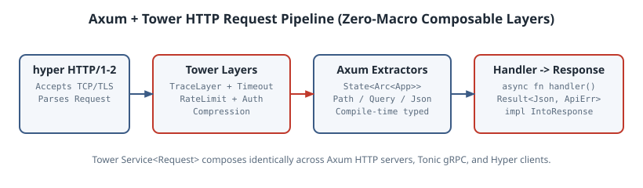

# Backend APIs with Axum: Routing, Extractors, and State

**Axum** (maintained by the Tokio team) has become the standard Rust backend web framework because it avoids magic procedural macros and instead relies on Rust's type system and **Tower** middleware. Every handler is a plain `async fn` whose parameter types declare exactly what must be extracted from the incoming HTTP request.



## Extractors: Compile-Time Request Validation

Axum parses request parts in parameter order. Extractors that only read metadata (`State`, `Path`, `Query`, `HeaderMap`) can appear in any order, while **at most one body-consuming extractor** (`Json<T>`, `String`, `Bytes`) must appear last:

```rust
use axum::{
    extract::{Path, State},
    http::StatusCode,
    response::{IntoResponse, Response},
    routing::{get, post},
    Json, Router,
};
use serde::{Deserialize, Serialize};
use std::collections::HashMap;
use std::sync::{Arc, RwLock};

#[derive(Clone, Default)]
struct AppState {
    items: Arc<RwLock<HashMap<u64, String>>>,
}

#[derive(Deserialize)]
struct CreateItem {
    id: u64,
    name: String,
}

#[derive(Serialize)]
struct ItemResponse {
    id: u64,
    name: String,
}

enum ApiError {
    NotFound,
    EmptyName,
}

impl IntoResponse for ApiError {
    fn into_response(self) -> Response {
        let (status, msg) = match self {
            ApiError::NotFound => (StatusCode::NOT_FOUND, "item not found"),
            ApiError::EmptyName => (StatusCode::BAD_REQUEST, "name cannot be empty"),
        };
        (status, Json(serde_json::json!({ "error": msg }))).into_response()
    }
}

async fn create_item(
    State(state): State<AppState>,
    Json(payload): Json<CreateItem>,
) -> Result<(StatusCode, Json<ItemResponse>), ApiError> {
    if payload.name.trim().is_empty() {
        return Err(ApiError::EmptyName);
    }
    state.items.write().unwrap().insert(payload.id, payload.name.clone());
    Ok((StatusCode::CREATED, Json(ItemResponse { id: payload.id, name: payload.name })))
}

async fn get_item(
    State(state): State<AppState>,
    Path(id): Path<u64>,
) -> Result<Json<ItemResponse>, ApiError> {
    let guard = state.items.read().unwrap();
    let name = guard.get(&id).cloned().ok_or(ApiError::NotFound)?;
    Ok(Json(ItemResponse { id, name }))
}

pub fn build_router(state: AppState) -> Router {
    Router::new()
        .route("/items", post(create_item))
        .route("/items/{id}", get(get_item))
        .with_state(state)
}
```

> [!TIP]
> Keep `AppState` cheap to clone by wrapping inner pools and maps in `Arc` (or deriving `Clone` on a struct of `Arc`s and `sqlx::PgPool`, which is already `Arc`-backed). Never hold a `std::sync::MutexGuard` or `RwLockGuard` across an `.await` point—scope the lock tightly or use `tokio::sync::RwLock` when async work happens inside the critical section.

## Hands-On Lab: In-Memory Router Integration Test Without Opening a Port

Because Axum's `Router` implements `tower::Service<Request>`, you can test every route, status code, and JSON body in milliseconds using `tower::ServiceExt::oneshot` without binding a TCP socket:

```rust
use axum::body::Body;
use axum::http::{Request, StatusCode};
use tower::ServiceExt; // provides `.oneshot()`

#[tokio::test]
async fn test_missing_item_returns_404() {
    let app = build_router(AppState::default());
    let req = Request::builder().uri("/items/999").body(Body::empty()).unwrap();
    let resp = app.oneshot(req).await.unwrap();
    assert_eq!(resp.status(), StatusCode::NOT_FOUND);
}
```
