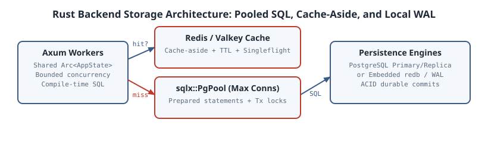

# PostgreSQL, `sqlx`, and Connection Pooling

Rust's database ecosystem offers two distinct philosophies: ORM-driven query builders (`diesel`, `sea-orm`) and **SQL-first compile-time verification (`sqlx`)**. With `sqlx`, you write real PostgreSQL or SQLite SQL—retaining full access to CTEs, window functions, `JSONB`, and `SELECT FOR UPDATE`—while the compiler checks every column name, nullability, and Rust type mapping before your binary ever ships.



## Configuring a Production `PgPool`

Opening a fresh TCP + TLS + PostgreSQL authentication handshake per HTTP request caps throughput at a few hundred requests per second. Always share a bounded `sqlx::PgPool` inside `AppState`:

```rust
use sqlx::postgres::PgPoolOptions;
use sqlx::{FromRow, PgPool};
use std::time::Duration;

#[derive(Debug, FromRow)]
pub struct Account {
    pub id: i64,
    pub balance_cents: i64,
}

pub async fn connect_pool(database_url: &str) -> Result<PgPool, sqlx::Error> {
    PgPoolOptions::new()
        .max_connections(20)
        .min_connections(4)
        .acquire_timeout(Duration::from_secs(3))
        .idle_timeout(Duration::from_secs(300))
        .connect(database_url)
        .await
}
```

## Atomic Transactions and Row-Level Locking

Transferring funds between two accounts requires both a transaction (`pool.begin().await?`) and row-level locking (`FOR UPDATE`) in deterministic ID order to prevent deadlocks:

```rust
pub async fn transfer_cents(
    pool: &PgPool,
    from_id: i64,
    to_id: i64,
    amount: i64,
) -> Result<(), sqlx::Error> {
    let mut tx = pool.begin().await?;

    // Lock rows in ascending ID order so concurrent transfers never deadlock
    let (first, second) = if from_id < to_id { (from_id, to_id) } else { (to_id, from_id) };
    let _locked = sqlx::query_as::<_, Account>(
        "SELECT id, balance_cents FROM accounts WHERE id IN ($1, $2) ORDER BY id FOR UPDATE",
    )
    .bind(first)
    .bind(second)
    .fetch_all(&mut *tx)
    .await?;

    sqlx::query("UPDATE accounts SET balance_cents = balance_cents - $1 WHERE id = $2")
        .bind(amount)
        .bind(from_id)
        .execute(&mut *tx)
        .await?;

    sqlx::query("UPDATE accounts SET balance_cents = balance_cents + $1 WHERE id = $2")
        .bind(amount)
        .bind(to_id)
        .execute(&mut *tx)
        .await?;

    tx.commit().await
}
```

> [!IMPORTANT]
> If an early `?` return happens before `tx.commit().await`, `sqlx::Transaction`'s `Drop` implementation automatically schedules a `ROLLBACK` on the underlying connection—preventing leaked open transactions.

## Offline Compile-Time Verification in CI

`sqlx::query_as!` normally connects to `DATABASE_URL` during `cargo build`. For reproducible CI builds without a live Postgres container, run `cargo sqlx prepare` locally to commit `.sqlx/` query metadata JSON files, then build in CI with `SQLX_OFFLINE=true`.

## Hands-On Lab: Deterministic Lock-Ordering Check

Verify why sorting lock IDs prevents classic AB/BA deadlocks in concurrent transfers:

```rust
fn lock_order(a: i64, b: i64) -> (i64, i64) {
    if a <= b { (a, b) } else { (b, a) }
}

fn main() {
    // Thread 1 transfers 10 -> 20; Thread 2 transfers 20 -> 10
    assert_eq!(lock_order(10, 20), (10, 20));
    assert_eq!(lock_order(20, 10), (10, 20));
    println!("Both transactions acquire row 10 before row 20 -> deadlock impossible.");
}
```
