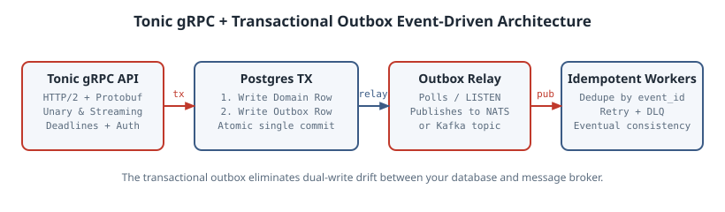

# gRPC and Protobuf Services with `tonic`

Internal microservice-to-microservice RPC benefits enormously from strongly typed schemas, binary Protocol Buffer framing, HTTP/2 multiplexing, and native streaming. **`tonic`** (built on `hyper`, `tower`, and `prost`) gives Rust first-class gRPC servers and clients that share the exact same Tower middleware ecosystem as Axum.



## Schema-First Contract (`proto/orders.proto`)

```protobuf
syntax = "proto3";
package orders.v1;

service OrderService {
  rpc CreateOrder (CreateOrderRequest) returns (OrderReply);
  rpc WatchStatus (WatchRequest) returns (stream StatusEvent);
}

message CreateOrderRequest {
  string customer_id = 1;
  uint64 amount_cents = 2;
}

message OrderReply {
  string order_id = 1;
  string status = 2;
}

message WatchRequest {
  string order_id = 1;
}

message StatusEvent {
  string status = 1;
  int64 unix_ms = 2;
}
```

Compile the `.proto` definitions automatically during `cargo build` using `tonic-build` inside `build.rs`:

```rust
// build.rs
fn main() -> Result<(), Box<dyn std::error::Error>> {
    tonic_build::compile_protos("proto/orders.proto")?;
    Ok(())
}
```

## Implementing a `tonic` Service with Deadlines and Streaming

```rust
use tokio::sync::mpsc;
use tokio_stream::wrappers::ReceiverStream;
use tonic::{Request, Response, Status};

pub mod orders {
    tonic::include_proto!("orders.v1");
}

use orders::order_service_server::OrderService;
use orders::{CreateOrderRequest, OrderReply, StatusEvent, WatchRequest};

#[derive(Default)]
pub struct MyOrderService;

#[tonic::async_trait]
impl OrderService for MyOrderService {
    type WatchStatusStream = ReceiverStream<Result<StatusEvent, Status>>;

    async fn create_order(
        &self,
        request: Request<CreateOrderRequest>,
    ) -> Result<Response<OrderReply>, Status> {
        let req = request.into_inner();
        if req.amount_cents == 0 {
            return Err(Status::invalid_argument("amount_cents must be > 0"));
        }
        Ok(Response::new(OrderReply {
            order_id: format!("ord-{}", req.customer_id),
            status: "ACCEPTED".into(),
        }))
    }

    async fn watch_status(
        &self,
        _request: Request<WatchRequest>,
    ) -> Result<Response<Self::WatchStatusStream>, Status> {
        let (tx, rx) = mpsc::channel(8);
        tokio::spawn(async move {
            for stage in ["ACCEPTED", "PACKED", "SHIPPED"] {
                let evt = StatusEvent { status: stage.into(), unix_ms: 0 };
                if tx.send(Ok(evt)).await.is_err() {
                    break; // Client disconnected
                }
            }
        });
        Ok(Response::new(ReceiverStream::new(rx)))
    }
}
```

> [!IMPORTANT]
> Always set per-RPC timeouts on clients (`req.set_timeout(Duration::from_secs(2))`). Without deadlines, a slow downstream service holds HTTP/2 streams and worker tasks open indefinitely, cascading latency upstream.

## Hands-On Lab: Map Domain Errors Cleanly to gRPC Status Codes

Practice mapping application error enums onto canonical gRPC status codes so clients know whether to retry (`Unavailable` / `DeadlineExceeded`) or stop (`InvalidArgument` / `NotFound`):

```rust
#[derive(Debug)]
enum DomainErr { NotFound, BadInput, DbBusy }

fn to_grpc_code(err: DomainErr) -> (&'static str, bool) {
    match err {
        DomainErr::NotFound => ("NOT_FOUND", false),
        DomainErr::BadInput => ("INVALID_ARGUMENT", false),
        DomainErr::DbBusy => ("UNAVAILABLE", true), // Safe to retry with jitter
    }
}

fn main() {
    for err in [DomainErr::NotFound, DomainErr::BadInput, DomainErr::DbBusy] {
        let (code, retryable) = to_grpc_code(err);
        println!("{code:<18} retryable={retryable}");
    }
}
```
