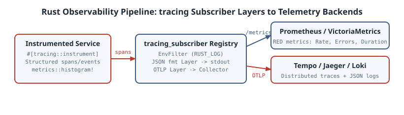

# Structured Tracing, Metrics, and OpenTelemetry

Plain `println!` logs break down the moment an async Rust server handles 500 concurrent requests on 8 Tokio worker threads: log lines interleave without request IDs, durations disappear, and you cannot trace a slow call across microservices. The **`tracing`** ecosystem solves this with async-aware **spans** that automatically attach structured fields across `.await` points and export to JSON logs, Prometheus, and OpenTelemetry collectors simultaneously.



## Spans vs. Events in `tracing`

- **Event (`tracing::info!`, `tracing::warn!`):** A single point-in-time structured log record (`user_id = 42, latency_ms = 18`).
- **Span (`#[tracing::instrument]`):** A duration with a start time, end time, parent span ID, and attached key-value context. Because `tracing` hooks into `Future::poll`, entering and exiting spans tracks async task switches accurately across worker threads.

```rust
use tracing::{info, instrument, warn};
use tracing_subscriber::{fmt, layer::SubscriberExt, util::SubscriberInitExt, EnvFilter};

pub fn init_telemetry() {
    let filter = EnvFilter::try_from_default_env()
        .unwrap_or_else(|_| EnvFilter::new("info,sqlx=warn"));

    tracing_subscriber::registry()
        .with(filter)
        .with(fmt::layer().json().with_target(true))
        .init();
}

// Always skip large or sensitive arguments (like passwords or DB pools)
#[instrument(skip(password_hash), fields(tenant = %tenant_id))]
pub async fn authenticate_user(tenant_id: &str, user_id: u64, password_hash: &str) -> bool {
    info!(user_id, "checking user credentials");
    if password_hash.is_empty() {
        warn!(user_id, "empty credential hash rejected");
        return false;
    }
    true
}
```

## RED Metrics with `metrics` and Prometheus

Every backend service should expose three golden **RED** metrics on `/metrics`:

- **Rate:** `metrics::counter!("http_requests_total", "route" => route, "status" => status).increment(1);`
- **Errors:** Derived from `status =~ "5.."` on the request counter.
- **Duration:** `metrics::histogram!("http_request_duration_seconds", "route" => route).record(elapsed.as_secs_f64());`

> [!WARNING]
> Never place unbounded high-cardinality values (such as raw `user_id`, `order_id`, or full URL paths with UUIDs) into Prometheus metric labels—they explode time-series memory and crash Prometheus. Put high-cardinality IDs in **structured logs and traces**, and use normalized route templates (`/items/{id}`) in metrics.

## Hands-On Lab: Measure Structured Latency Histograms in Pure Rust

```rust
use std::time::Instant;

fn percentile(sorted: &[u128], p: f64) -> u128 {
    let idx = ((sorted.len() as f64 - 1.0) * p).round() as usize;
    sorted[idx]
}

fn main() {
    let mut samples_ns = Vec::with_capacity(1_000);
    for i in 0..1_000u64 {
        let start = Instant::now();
        let _acc: u64 = (0..200).map(|x| x.wrapping_mul(i)).sum();
        samples_ns.push(start.elapsed().as_nanos());
    }
    samples_ns.sort_unstable();
    println!(
        "p50={}ns | p95={}ns | p99={}ns",
        percentile(&samples_ns, 0.50),
        percentile(&samples_ns, 0.95),
        percentile(&samples_ns, 0.99),
    );
}
```
