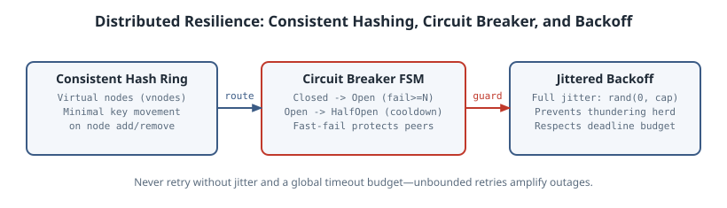

# Distributed Resilience, Consistent Hashing, and Consensus

Single-node Rust services rarely crash, which makes **partial network failures**—slow peers, split-brain partitions, and cascading retry storms—the dominant failure mode in distributed systems. Rust's algebraic enums (`enum State { Closed, Open, HalfOpen }`) model fault-tolerance state machines with compile-time exhaustiveness.



## Three Essential Resilience Primitives

1. **Circuit Breaker FSM:** Tracks consecutive upstream failures. Once failures cross a threshold, transitions to `Open` and immediately short-circuits requests for a cooldown window, giving the overloaded dependency room to recover before probing in `HalfOpen`.
2. **Consistent Hashing with Virtual Nodes:** Maps both servers and keys onto a $2^{64}$ hash ring using multiple virtual nodes (`vnodes`) per physical server. Adding or removing a node reassigns only $\approx 1/N$ of keys instead of invalidating the entire cache.
3. **Raft Consensus (`openraft` / `raft-rs`):** Replicates a deterministic state machine log across a quorum ($2f+1$ nodes) using leader election, term numbers, and majority commit indexes so cluster metadata survives node loss without split-brain writes.

## Pure-Rust Circuit Breaker + Consistent Hash Ring

```rust
use std::collections::BTreeMap;
use std::hash::{DefaultHasher, Hash, Hasher};
use std::time::{Duration, Instant};

#[derive(Debug, Clone, Copy, PartialEq, Eq)]
pub enum BreakerState {
    Closed,
    Open(Instant),
    HalfOpen,
}

pub struct CircuitBreaker {
    state: BreakerState,
    failures: u32,
    threshold: u32,
    cooldown: Duration,
}

impl CircuitBreaker {
    pub fn new(threshold: u32, cooldown: Duration) -> Self {
        Self { state: BreakerState::Closed, failures: 0, threshold, cooldown }
    }

    pub fn allow_request(&mut self) -> bool {
        match self.state {
            BreakerState::Closed | BreakerState::HalfOpen => true,
            BreakerState::Open(opened_at) if opened_at.elapsed() >= self.cooldown => {
                self.state = BreakerState::HalfOpen;
                true
            }
            BreakerState::Open(_) => false,
        }
    }

    pub fn record_success(&mut self) {
        self.failures = 0;
        self.state = BreakerState::Closed;
    }

    pub fn record_failure(&mut self) {
        self.failures += 1;
        if self.failures >= self.threshold {
            self.state = BreakerState::Open(Instant::now());
        }
    }
}

pub struct HashRing {
    ring: BTreeMap<u64, String>,
}

impl HashRing {
    pub fn new(nodes: &[&str], vnodes: usize) -> Self {
        let mut ring = BTreeMap::new();
        for &node in nodes {
            for v in 0..vnodes {
                ring.insert(Self::hash_key(&format!("{node}#v{v}")), node.to_string());
            }
        }
        Self { ring }
    }

    fn hash_key(s: &str) -> u64 {
        let mut h = DefaultHasher::new();
        s.hash(&mut h);
        h.finish()
    }

    pub fn route(&self, key: &str) -> Option<&str> {
        let h = Self::hash_key(key);
        self.ring
            .range(h..)
            .next()
            .or_else(|| self.ring.iter().next())
            .map(|(_, node)| node.as_str())
    }
}
```

## Hands-On Lab: Verify Circuit Breaker Trip and Key Stability

```rust
fn main() {
    let mut cb = CircuitBreaker::new(2, Duration::from_secs(30));
    assert!(cb.allow_request());
    cb.record_failure();
    cb.record_failure();
    assert!(!cb.allow_request(), "Breaker must short-circuit after threshold");

    let ring = HashRing::new(&["shard-a", "shard-b", "shard-c"], 64);
    for key in ["user:101", "user:202", "order:999"] {
        println!("{key:<10} -> {}", ring.route(key).unwrap());
    }
}
```
