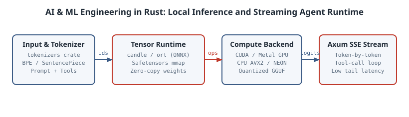

# AI and Machine Learning Engineering in Rust

Python dominates model research, but **Rust increasingly powers production AI infrastructure**: Hugging Face's `tokenizers` and `safetensors`, `candle` (minimalist ML framework), `ort` (ONNX Runtime bindings), `qdrant` (vector database), and high-concurrency LLM gateways/agent runtimes where low tail latency and predictable memory matter.



## The Rust AI Ecosystem Map

| Layer | Leading Crates | Production Role |
| :--- | :--- | :--- |
| **Tokenization** | `tokenizers`, `tiktoken-rs` | Fast BPE/WordPiece encoding & token budgeting without Python GIL |
| **Weight loading** | `safetensors`, `memmap2` | Zero-copy memory-mapped model loading without `pickle` RCE risk |
| **Local inference** | `candle-core`, `ort`, `burn` | Running embeddings, classifiers, Whisper, or quantized LLMs on CPU/CUDA/Metal |
| **Vector search** | `qdrant-client`, `hnsw_rs`, `usearch` | Sub-millisecond cosine/dot-product retrieval for RAG pipelines |
| **Streaming APIs & Agents** | `reqwest` + `eventsource-stream` + `axum` | Tool-calling loops, structured JSON outputs, SSE token streaming |

## Numerically Stable Softmax and Cosine Similarity in Pure Rust

Every embedding search and transformer sampling head relies on two core numerical primitives: **cosine similarity** (for semantic retrieval) and **numerically stable softmax** (subtracting `max(logits)` before `exp()` to prevent `f32` overflow):

```rust
pub fn cosine_similarity(a: &[f32], b: &[f32]) -> f32 {
    assert_eq!(a.len(), b.len());
    let mut dot = 0.0f32;
    let mut norm_a = 0.0f32;
    let mut norm_b = 0.0f32;
    for (&x, &y) in a.iter().zip(b.iter()) {
        dot += x * y;
        norm_a += x * x;
        norm_b += y * y;
    }
    let denom = norm_a.sqrt() * norm_b.sqrt();
    if denom == 0.0 { 0.0 } else { dot / denom }
}

pub fn stable_softmax(logits: &[f32], temperature: f32) -> Vec<f32> {
    let t = temperature.max(1e-6);
    let max_val = logits.iter().copied().fold(f32::NEG_INFINITY, f32::max);
    let exps: Vec<f32> = logits.iter().map(|&x| ((x - max_val) / t).exp()).collect();
    let sum: f32 = exps.iter().sum();
    exps.into_iter().map(|e| e / sum).collect()
}
```

## Typed Tool-Calling Dispatch for Rust Agents

Rust's tagged enums paired with `serde` make LLM tool-calling loops completely type-safe—invalid tool names or missing fields fail deserialization cleanly before executing any side effect:

```rust
enum ToolCall {
    SearchDocs { query: String, limit: usize },
    FetchMetric { service: String },
}

fn dispatch_tool(call: ToolCall) -> String {
    match call {
        ToolCall::SearchDocs { query, limit } => format!("searched '{query}' (top {limit})"),
        ToolCall::FetchMetric { service } => format!("p99 latency for {service}: 14.2ms"),
    }
}
```

## Hands-On Lab: Run Top-K Semantic Retrieval and Softmax Sampling

```rust
fn main() {
    let query = [0.9f32, 0.1, 0.0];
    let docs = [
        ("rust-networking", [0.88f32, 0.15, 0.02]),
        ("cooking-recipes", [0.05f32, 0.10, 0.99]),
        ("tokio-async-io",  [0.92f32, 0.08, 0.01]),
    ];

    let mut scored: Vec<_> = docs
        .iter()
        .map(|(title, emb)| (*title, cosine_similarity(&query, emb)))
        .collect();
    scored.sort_by(|a, b| b.1.total_cmp(&a.1));

    for (title, score) in &scored {
        println!("{title:<18} similarity={score:.4}");
    }

    let probs = stable_softmax(&[2.5, 1.0, 0.2], 0.8);
    println!("Softmax probabilities: {probs:?}");
    let _ = dispatch_tool(ToolCall::FetchMetric { service: "inference-gw".into() });
}
```
