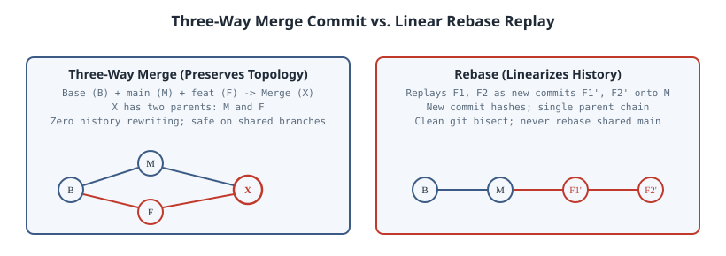

# Three-Way Merge Explained

After this page you can draw the three inputs Git uses when two branches diverged.

## The three trees

Call them:

| Name | What |
|------|------|
| Base | Merge base: latest common ancestor of both tips |
| Ours | The branch you have checked out (`HEAD`) |
| Theirs | The branch you named in `git merge` |

Git diffs base→ours and base→theirs, then applies both diffs to the base. That is a **three-way merge**. A two-way merge (ours vs theirs only) cannot tell “we both added the same line” from “they added a line we never had.”

```text
          C  base     (merge-base main feat)
         / \
        /   \
      G     E         ours = main, theirs = feat
        \   /
         \ /
          M  result   two-parent merge commit
```

## See the base

```bash
cd ~/desk/desk-api
git merge-base main feat/ping-json
git log --oneline --graph main feat/ping-json
```

`merge-base` prints one hash. `git log --graph` should make that node obvious.

## Stages in the index during a conflict

When both sides changed the same hunk, Git records three stages for that path in the index:

| Stage | Content |
|-------|---------|
| 1 | base |
| 2 | ours |
| 3 | theirs |

```bash
git ls-files -u
```

`git checkout --ours path` / `--theirs path` copies stage 2 or 3 into the working tree. You still `git add` after you edit. The next page is the full conflict loop.

## Why this matters for a forge

A pull request / merge request is this same three-way merge, run on the server when you click Merge. The conflict you see in the UI is stages 2 and 3 plus markers. Learning it locally means the UI is not a new theory.

## `zdiff3` markers



With `merge.conflictstyle zdiff3` (chapter 2) a conflicted file shows the common ancestor as well as ours and theirs. That extra block is the base. Read it before you delete markers.

## Hands-On Lab: Inspect All Three Merge Stages During a Conflict

Trigger a deliberate conflict and inspect stages 1 (base), 2 (ours), and 3 (theirs) directly in the index:

```bash
mkdir -p /tmp/vcs-merge-lab && cd /tmp/vcs-merge-lab
git init -b main
git config merge.conflictstyle zdiff3
printf "timeout=5\nretries=3\n" > config.ini && git add config.ini && git commit -m "base"

git switch -c feat
printf "timeout=15\nretries=3\n" > config.ini && git commit -am "feat timeout 15"

git switch main
printf "timeout=10\nretries=3\n" > config.ini && git commit -am "main timeout 10"

# Trigger three-way merge conflict and inspect the 3 index stages
git merge feat || true
git ls-files -u
git show :1:config.ini   # Base
git show :2:config.ini   # Ours (main)
git show :3:config.ini   # Theirs (feat)
```
