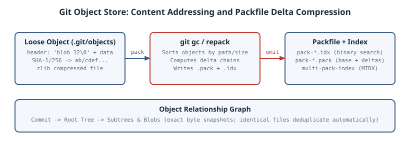

# The Object Store and Packfiles

Every file version, directory listing, commit snapshot, and annotated tag in Git lives inside `.git/objects/` as an immutable, content-addressed object. Understanding how Git encodes, hashes, and compresses these objects explains why identical files across branches cost zero extra disk space and why `git gc` can shrink a 500 MB repository down to 25 MB.



## Loose Objects: Header, Null Byte, Payload, Zlib

When you run `git add` or `git commit`, Git creates a **loose object**. Before hashing, Git prepends an ASCII header containing the object type (`blob`, `tree`, `commit`, or `tag`), a space, the exact byte length of the payload, and a NUL (`\0`) byte:

```text
blob 12\0hello world\n
```

Git hashes that exact byte stream with SHA-1 (or SHA-256 in modern repositories initialized with `--object-format=sha256`), zlib-compresses the stream, and writes it to `.git/objects/<first-2-hex>/<remaining-38-hex>`.

| Object Type | Stores | References |
| :--- | :--- | :--- |
| `blob` | Raw file contents (no filename, no permissions) | None |
| `tree` | Directory entries: file mode, type, hash, filename | Blobs and subtrees |
| `commit` | Root tree hash, parent hash(es), author, committer, message | One root tree + zero or more parent commits |
| `tag` | Annotated tag metadata, tagger, optional signature | Target object (usually a commit) |

## Packfiles and Delta Compression

Storing every revision of a 10,000-line file as a separate zlib-compressed loose object wastes disk space and slows down network fetches. Periodically—during `git gc`, `git maintenance`, or before pushing over the wire—Git bundles loose objects into a **packfile** (`pack-<hash>.pack`) paired with a binary-search **index** (`pack-<hash>.idx`):

1. **Heuristic grouping:** Git sorts objects by type, pathname, and descending size so different versions of the same file sit next to each other.
2. **Sliding-window delta compression:** Within a window (default 10 objects), Git stores the newest version as a full base object and encodes older versions as binary deltas (`OFS_DELTA` or `REF_DELTA`) referencing that base. Storing the newest version whole makes checking out `HEAD` fast.
3. **Multi-pack index (MIDX) and bitmaps:** Large repositories add a `multi-pack-index` and `.bitmap` reachability index so `git log` and `git clone` skip scanning dozens of separate `.idx` files.

> [!TIP]
> Never manually edit or delete files under `.git/objects/`. Because every hash depends on the exact object bytes, even a one-bit change breaks `git fsck` integrity checks across every descendant commit.

## Hands-On Lab: Hash and Decompress a Loose Object with Python

Verify Git's exact hashing and zlib compression format in a scratch repository without relying on Git's porcelain commands:

```bash
mkdir -p /tmp/vcs-obj-lab && cd /tmp/vcs-obj-lab
git init -b main
printf "hello world\n" > greeting.txt
git add greeting.txt

# 1. Inspect the hash Git computed for the staged blob
HASH=$(git hash-object greeting.txt)
echo "Git hash: $HASH"
ls -la ".git/objects/${HASH:0:2}/${HASH:2}"

# 2. Decompress the loose object directly with Python and verify SHA-1
python3 - <<PY
import hashlib, zlib, pathlib
h = "$HASH"
raw = zlib.decompress(pathlib.Path(f".git/objects/{h[:2]}/{h[2:]}").read_bytes())
print("Raw object bytes:", raw)
print("Matches SHA-1:   ", hashlib.sha1(raw).hexdigest() == h)
PY

# 3. Repack into a packfile and inspect delta statistics
git commit -m "add greeting"
git gc --aggressive
git verify-pack -v .git/objects/pack/pack-*.idx
```
