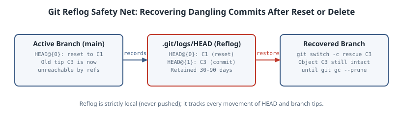

# How the Reflog Works

In Git, a commit is almost never destroyed immediately when you run `git reset --hard`, `git rebase`, or `git branch -D`. As long as an object was committed at least once, it stays inside `.git/objects/` as a **dangling commit** until garbage collection prunes it. The **reflog** is Git's local journal of every position `HEAD` and every local branch ref has pointed to, giving you exact coordinates to rescue lost work.



## What Git Records in `.git/logs/`

Every time a reference moves—via `commit`, `checkout`, `switch`, `merge`, `rebase`, `reset`, or `cherry-pick`—Git appends a line to `.git/logs/HEAD` and `.git/logs/refs/heads/<branch>`. Each line stores the old hash, the new hash, the committer identity and Unix timestamp, and a short reason string:

```text
0000000000... a1b2c3d4e5... User <user@example.org> 1732500000 +0000  commit (initial): init
a1b2c3d4e5... f9e8d7c6b5... User <user@example.org> 1732500120 +0000  commit: add parser
f9e8d7c6b5... a1b2c3d4e5... User <user@example.org> 1732500240 +0000  reset: moving to HEAD~1
```

You can address any historical entry with `HEAD@{n}` (steps ago) or time-based syntax like `main@{15 minutes ago}` or `HEAD@{yesterday}`.

## Retention Windows and Boundaries

- **Reachable entries (`gc.reflogExpire`):** Retained for **90 days** by default.
- **Unreachable entries (`gc.reflogExpireUnreachable`):** Retained for **30 days** by default, after which `git gc` expires the reflog entry and prunes the unreferenced commit objects.
- **Strictly local:** Reflogs are never pushed or fetched. If you delete a local repository directory, its reflog goes with it.
- **Only committed snapshots:** Uncommitted edits wiped by `git reset --hard` or `git checkout -- <file>` were never recorded in `.git/logs/HEAD` (though files staged via `git add` still exist briefly as dangling blobs discoverable via `git fsck --lost-found`).

> [!IMPORTANT]
> When recovering from a bad rebase or reset, always inspect `git reflog` first and create a new rescue branch (`git switch -c rescue HEAD@{2}`) rather than immediately running another `reset --hard`.

## Hands-On Lab: Deliberately Lose a Branch and Rescue It

Practice recovering a commit after both `git reset --hard` and `git branch -D`:

```bash
mkdir -p /tmp/vcs-reflog-lab && cd /tmp/vcs-reflog-lab
git init -b main
echo "v1" > app.py && git add app.py && git commit -m "initial"

# Create a feature branch with valuable work, then delete it forcefully
git switch -c exp-feature
echo "def important(): return 42" >> app.py
git commit -am "implement important feature"
git switch main
git branch -D exp-feature

# 1. Inspect the reflog to locate the deleted branch tip
git reflog -n 10

# 2. Recover the lost commit onto a new branch using its reflog entry
LOST_HASH=$(git reflog --grep-reflog="implement important feature" -n 1 --format="%H")
git switch -c recovered-feature "$LOST_HASH"
cat app.py
```
