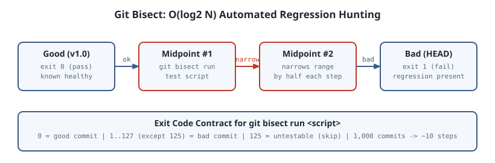

# Binary Searching Bugs with Git Bisect

When a production regression appears somewhere across 500 commits since the last release, reading diffs one by one wastes hours. `git bisect` performs a **binary search over the commit DAG**, isolating the exact commit that introduced the bug in $\lceil \log_2 N \rceil$ steps—roughly 9 steps for 500 commits, or 10 steps for 1,000 commits.



## Manual vs. Automated Bisect

Every bisect session requires two endpoints:
- A **bad** commit (usually `HEAD`) where the bug reproduces.
- A **good** commit (an older release tag or SHA) where the behavior was definitely healthy.

Git checks out the midpoint commit in detached `HEAD` state. You test it, mark it `git bisect good` or `git bisect bad` (or `git bisect skip` if that revision fails to compile), and repeat until one commit remains.

When you can express the failure as a shell command or unit test, **`git bisect run`** eliminates manual stepping completely:

```bash
git bisect start HEAD v2.4.0
git bisect run ./scripts/check-regression.sh
# When finished, always return to your original branch:
git bisect reset
```

### The Exit Code Contract

| Script Exit Code | Meaning to `git bisect run` | Action Taken |
| :--- | :--- | :--- |
| `0` | Commit is **good** | Searches newer half of remaining range |
| `1`–`127` (except `125`) | Commit is **bad** | Searches older half of remaining range |
| `125` | Commit is **untestable** (e.g., broken build) | Skips commit and picks a nearby revision |
| `128`–`255` | Fatal script error | Aborts the entire bisect session immediately |

> [!TIP]
> If you are hunting for the commit that **fixed** a bug or improved performance rather than broke something, use custom terms (`git bisect start --term-old=broken --term-new=fixed`) so your mental model stays aligned with the command output.

## Hands-On Lab: Automatically Pinpoint a Regression Across 20 Commits

Build a synthetic 20-commit repository where commit #13 introduces an off-by-one bug, then let `git bisect run` find it automatically in ~4 steps:

```bash
mkdir -p /tmp/vcs-bisect-lab && cd /tmp/vcs-bisect-lab
git init -b main

cat > calc.py <<'PY'
def add(a, b):
    return a + b
PY
git add calc.py && git commit -m "commit 01: baseline"
git tag v1.0

for i in $(seq -w 2 20); do
  if [ "$i" = "13" ]; then
    cat > calc.py <<'PY'
def add(a, b):
    return a + b + 1  # accidental regression
PY
  else
    echo "# changelog entry $i" >> CHANGELOG.md
  fi
  git add -A && git commit -q -m "commit $i"
done

# Run automated bisect using a one-line Python assertion
git bisect start HEAD v1.0
git bisect run python3 -c "import calc; assert calc.add(2, 3) == 5"

# Clean up and return to main
git bisect reset
```

Notice how Git identifies `commit 13` as the first bad commit in 4–5 evaluations instead of 20.
