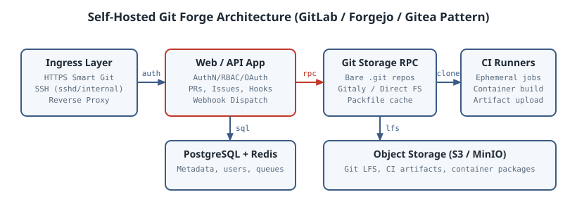

# Core Components of a Git Hosting Platform

Running `git init --bare` on a server gives you a remote, not a forge. A production Git hosting platform—whether GitLab, Forgejo, Gitea, Bitbucket, or GitHub Enterprise—wraps bare Git repositories in six cooperating subsystems that handle authentication, Git wire transport, relational metadata, large-binary storage, event queues, and isolated CI execution.



## The Six Architectural Layers

| Layer | Responsibility | Examples |
| :--- | :--- | :--- |
| **Ingress & Smart Git Transport** | Terminates TLS/SSH, routes `git-upload-pack` (fetch) and `git-receive-pack` (push) | NGINX, Envoy, OpenSSH / built-in Go SSH |
| **Web & API Application** | Pull requests, issues, RBAC, branch protection, audit logs, webhook dispatch | Rails (GitLab), Go monolith (Forgejo/Gitea) |
| **Git Storage RPC** | Executes `git` subprocesses against bare repos on fast NVMe storage; caches packfiles | Gitaly (GitLab), local/NFS bare store (Forgejo) |
| **Relational DB + Queue** | Users, permissions, PR comments, merge states, background job queues | PostgreSQL + Redis / Valkey |
| **Object Storage** | Offloads Git LFS blobs, CI build artifacts, container registry layers, and backups | S3, MinIO, GCS |
| **Ephemeral CI Runners** | Pulls jobs over HTTPS, clones specific commit SHA, runs build steps in isolated containers/VMs | GitLab Runner, Forgejo Actions Runner |

## What Happens on a Single `git push`

Tracing a single `git push origin main` exposes how these layers coordinate:

1. **Ingress authenticates the user** (via SSH key fingerprint or HTTPS token) and verifies write permission against the Web/API layer.
2. **Git Storage receives the packfile** via `git-receive-pack` and writes objects into a temporary quarantine directory inside `.git/objects/incoming-*`.
3. **Server-side `pre-receive` hook calls the Web/API internal endpoint** to enforce branch protection rules, commit signature policies, and file-size caps. If denied, the quarantine directory is deleted and the repository never sees the objects.
4. **Ref update succeeds** and `post-receive` enqueues asynchronous jobs in Redis: updating PR diffs, triggering CI pipelines, recalculating language stats, and dispatching outbound webhooks.

> [!IMPORTANT]
> Never mount bare Git repositories over high-latency NFS for multi-node active-active writes without a dedicated Git RPC layer (such as Gitaly). Concurrent `git gc` and ref updates over NFS without serialized locking lead to corrupted packfiles and stale ref caches.

## Hands-On Lab: Inspect a Bare Repository and Server Hook Quarantine

Simulate how a Git forge receives a push and validates commits in a `pre-receive` hook before updating any branch ref:

```bash
mkdir -p /tmp/vcs-forge-lab && cd /tmp/vcs-forge-lab
git init --bare server.git

# Add a server-side pre-receive hook that rejects pushes to main without a ticket ID
cat > server.git/hooks/pre-receive <<'SH'
#!/usr/bin/env bash
set -euo pipefail
while read -r oldrev newrev refname; do
  if [ "$refname" = "refs/heads/main" ]; then
    msg=$(git log -1 --format=%s "$newrev")
    if ! printf '%s' "$msg" | grep -qE '^\[TICKET-[0-9]+\]'; then
      echo "REJECTED: commits to main must start with [TICKET-123]" >&2
      exit 1
    fi
  fi
done
SH
chmod +x server.git/hooks/pre-receive

# Clone, attempt a non-compliant push, then a compliant push
git clone /tmp/vcs-forge-lab/server.git client
cd client
git switch -c main
echo "hello" > app.txt && git add app.txt && git commit -m "wip change"
git push -u origin main || echo "Push blocked by pre-receive hook as expected"

git commit --amend -m "[TICKET-42] add app.txt"
git push -u origin main
```
