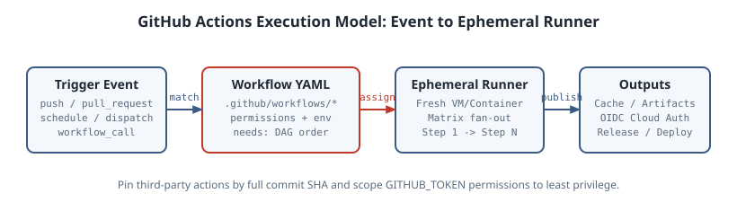

# Workflow Anatomy

A GitHub Actions workflow is a declarative YAML pipeline stored under `.github/workflows/*.yml`. Every workflow maps one or more repository events to a directed acyclic graph (DAG) of **jobs** that execute inside fresh, ephemeral virtual machines or containers.



## The Four Building Blocks

1. **Triggers (`on:`):** Events that start a workflow run (`push`, `pull_request`, `schedule`, `workflow_dispatch`, or `workflow_call` for reusable pipelines).
2. **Permissions (`permissions:`):** Explicit least-privilege scopes granted to the short-lived `GITHUB_TOKEN` (for example, `contents: read` at the top level, escalating only on the release job).
3. **Jobs (`jobs:`):** Independent units of execution that run in parallel by default unless ordered with `needs: [lint, test]`. Each job spins up its own runner (`runs-on: ubuntu-latest`) with a clean filesystem.
4. **Steps (`steps:`):** Sequential shell commands (`run:`) or reusable action modules (`uses:`) that share the job's workspace directory and environment variables.

## Production CI Workflow Blueprint

```yaml
name: Build and Verify

on:
  push:
    branches: [ main ]
  pull_request:

permissions:
  contents: read

concurrency:
  group: ci-${{ github.workflow }}-${{ github.ref }}
  cancel-in-progress: true

jobs:
  test:
    runs-on: ubuntu-latest
    strategy:
      fail-fast: false
      matrix:
        python-version: [ "3.11", "3.12" ]
    steps:
      - name: Checkout repository
        uses: actions/checkout@11bd71901bbe5b1630ceea73d27597364c9af683 # v4.2.2

      - name: Set up Python ${{ matrix.python-version }}
        uses: actions/setup-python@a26af69be951a213d495a4c3e4e4022e16d87065 # v5.6.0
        with:
          python-version: ${{ matrix.python-version }}
          cache: pip

      - name: Run unit test suite
        run: python3 -m unittest discover -s tests

  package:
    needs: [ test ]
    if: github.event_name == 'push' && github.ref == 'refs/heads/main'
    runs-on: ubuntu-latest
    steps:
      - uses: actions/checkout@11bd71901bbe5b1630ceea73d27597364c9af683 # v4.2.2
      - name: Build release archive
        run: tar -czf dist.tar.gz src/
      - name: Upload build artifact
        uses: actions/upload-artifact@ea165f8d65b6e75b540449e92b4886f43607fa02 # v4.6.2
        with:
          name: release-bundle
          path: dist.tar.gz
          retention-days: 14
```

> [!IMPORTANT]
> Always pin third-party `uses:` actions to a **full 40-character commit SHA** rather than a mutable tag like `@v4`. A compromised upstream repository can force-push a tag to point to malicious code; a commit SHA is cryptographically immutable.

## Hands-On Lab: Validate Workflow Syntax and Concurrency Locally

Verify workflow YAML structure and check for unpinned action tags using a quick local Python linter script:

```bash
python3 - <<'PY'
import re

workflow = """
steps:
  - uses: actions/checkout@v4
  - uses: actions/setup-python@a26af69be951a213d495a4c3e4e4022e16d87065
"""

for line_no, line in enumerate(workflow.splitlines(), 1):
    m = re.search(r'uses:\s*([^@\s]+)@([^\s#]+)', line)
    if m:
        action, ref = m.groups()
        pinned = bool(re.fullmatch(r'[0-9a-f]{40}', ref))
        status = "OK (SHA pinned)" if pinned else "WARN (mutable tag)"
        print(f"Line {line_no}: {action}@{ref} -> {status}")
PY
```
