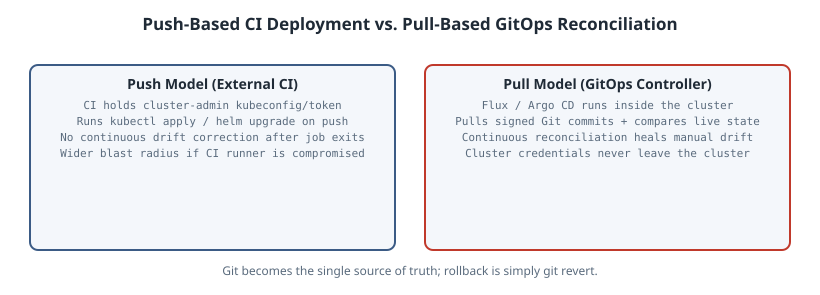

# Push vs. Pull Deployment Models

Both traditional CI/CD pipelines and GitOps systems deploy code from Git into Kubernetes clusters, but they invert the direction of control and the location of cluster credentials. Choosing between push and pull shapes your security boundary, drift resilience, and multi-cluster operational model.



## Architectural Trade-Offs

| Dimension | Push Model (External CI) | Pull Model (GitOps Controller) |
| :--- | :--- | :--- |
| **Credential boundary** | CI runner holds cluster kubeconfig or cloud deploy token | Cluster credentials stay inside the cluster; controller only needs read-only Git access |
| **Drift detection** | None after the CI job exits; manual `kubectl edit` persists silently | Continuous reconciliation loop detects and reverts manual drift within minutes |
| **Firewall & NAT** | CI must reach every Kubernetes API server over the network | Works cleanly inside private VPCs and air-gapped networks via outbound pull |
| **Rollback mechanism** | Re-run an older CI job (which may fail if dependencies changed) | `git revert` on the environment repo; controller converges automatically |
| **Multi-cluster fan-out** | CI loop iterates over cluster list sequentially or in matrix | Each cluster reconciles independently in parallel from the same Git repository |

## When Push Still Makes Sense

Push-based CI remains the right tool for **building, testing, scanning, and publishing immutable artifacts** (container images, Helm charts, SBOMs, signatures). In a mature GitOps architecture, CI pushes the verified container digest to a registry and opens (or merges) a commit updating the manifest repository—then the pull-based GitOps controller (Flux or Argo CD) takes over to converge the cluster.

> [!IMPORTANT]
> Never mix ad-hoc `kubectl apply` pushes with an active GitOps controller managing the same namespace. Either the controller will immediately overwrite your manual patch (`selfHeal: true`), or your cluster will sit in a permanent `OutOfSync` state that hides real deployment failures.

## Hands-On Lab: Simulate Drift Detection Locally

You can observe the core invariant of pull-based reconciliation—comparing desired Git state against live state—using a simple diff loop in bash:

```bash
mkdir -p /tmp/vcs-gitops-lab/{desired,live}
cat > /tmp/vcs-gitops-lab/desired/replicas.yaml <<'YAML'
apiVersion: apps/v1
kind: Deployment
metadata:
  name: desk-api
spec:
  replicas: 3
YAML
cp /tmp/vcs-gitops-lab/desired/replicas.yaml /tmp/vcs-gitops-lab/live/replicas.yaml

# 1. Simulate manual out-of-band drift in the live cluster
sed -i.bak 's/replicas: 3/replicas: 1/' /tmp/vcs-gitops-lab/live/replicas.yaml

# 2. Reconciliation check: detect drift and heal back to desired Git state
if ! diff -u /tmp/vcs-gitops-lab/desired/replicas.yaml /tmp/vcs-gitops-lab/live/replicas.yaml; then
  echo "Drift detected -> reconciling live state to desired Git manifest..."
  cp /tmp/vcs-gitops-lab/desired/replicas.yaml /tmp/vcs-gitops-lab/live/replicas.yaml
fi
diff -u /tmp/vcs-gitops-lab/desired/replicas.yaml /tmp/vcs-gitops-lab/live/replicas.yaml && echo "InSync"
```
