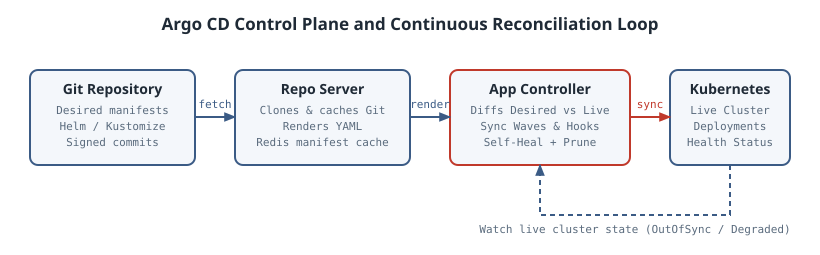

# The Argo CD Reconciliation Loop

Argo CD is a Kubernetes controller that continuously compares **desired state** rendered from Git against **live state** running in one or more target clusters. Every UI badge (`Synced`, `OutOfSync`, `Healthy`, `Degraded`) is the direct output of three cooperating control-plane components running this loop.



## The Three Core Components

1. **Repo Server (`argocd-repo-server`):** Stateless service that clones Git repositories, caches commits in Redis, and runs manifest generators (plain YAML, Kustomize, Helm, or Config Management Plugins) to produce normalized Kubernetes resource lists.
2. **Application Controller (`argocd-application-controller`):** Stateful reconciliation engine that watches live cluster resources via Kubernetes informers, compares them field-by-field against the Repo Server's desired manifests, evaluates resource health checks, and executes sync waves and hooks when changes are needed.
3. **API Server (`argocd-server`):** Exposes gRPC/REST endpoints for the web UI, `argocd` CLI, RBAC enforcement, SSO/OIDC authentication, and incoming Git webhooks that trigger immediate refreshes without waiting for the default 3-minute polling interval.

## Declarative `Application` Resource

```yaml
apiVersion: argoproj.io/v1alpha1
kind: Application
metadata:
  name: desk-api
  namespace: argocd
  finalizers:
    - resources-finalizer.argocd.argoproj.io
spec:
  project: default
  source:
    repoURL: <desk-infra-git-url>
    targetRevision: main
    path: apps/overlays/staging
  destination:
    name: in-cluster
    namespace: staging
  syncPolicy:
    automated:
      prune: true
      selfHeal: true
    syncOptions:
      - CreateNamespace=true
      - ServerSideApply=true
```

> [!NOTE]
> Adding `resources-finalizer.argocd.argoproj.io` ensures that deleting the `Application` object cascades deletion to the managed Kubernetes workloads. Omit the finalizer when you want deleting an Argo CD `Application` to leave running cluster resources untouched.

## Hands-On Lab: Trace Sync Status and Diffs via the CLI

On a cluster with Argo CD installed (see Chapter 52), inspect how the controller evaluates desired vs. live state:

```bash
# 1. Inspect sync and health status for every managed application
argocd app list

# 2. View the exact unified diff between Git desired state and live cluster state
argocd app diff desk-api

# 3. Force a hard refresh from Git (bypassing the Redis manifest cache)
argocd app get desk-api --hard-refresh

# 4. Preview a sync without mutating cluster resources
argocd app sync desk-api --dry-run
```
