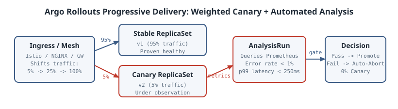

# Canary and Blue-Green Progressive Delivery

A standard Kubernetes `Deployment` only understands `RollingUpdate`: it replaces pods in fixed batches and considers a rollout successful the moment readiness probes return HTTP 200. It cannot shift 5% of real production traffic, query Prometheus for p99 latency regressions, and automatically abort if error rates spike. **Argo Rollouts** replaces `Deployment` with a `Rollout` CRD that orchestrates weighted **canary** and **blue-green** releases driven by live telemetry.



## Canary vs. Blue-Green Compared

| Dimension | Canary (`strategy.canary`) | Blue-Green (`strategy.blueGreen`) |
| :--- | :--- | :--- |
| **Traffic shift** | Gradual weighted steps (e.g., 5% → 25% → 50% → 100%) | Instant cutover from active Service to preview Service |
| **Resource overhead** | Low (only small extra canary ReplicaSet) | High (temporarily runs 2x full production capacity) |
| **Blast radius** | Limited to small percentage of live traffic | Zero live traffic during preview; 100% on cutover |
| **Best fit** | High-traffic stateless APIs with real-time error/latency metrics | Apps incompatible with two versions running concurrently |

## Weighted Canary Rollout with Automated Prometheus Gate

```yaml
apiVersion: argoproj.io/v1alpha1
kind: Rollout
metadata:
  name: desk-api
  namespace: production
spec:
  replicas: 6
  revisionHistoryLimit: 3
  selector:
    matchLabels:
      app: desk-api
  template:
    metadata:
      labels:
        app: desk-api
    spec:
      containers:
        - name: api
          image: ghcr.io/example/desk-api:2.1.0
          ports:
            - containerPort: 8080
  strategy:
    canary:
      analysis:
        templates:
          - templateName: http-success-rate
        startingStep: 1
        args:
          - name: service-name
            value: desk-api.production.svc.cluster.local
      steps:
        - setWeight: 10
        - pause: { duration: 2m }
        - setWeight: 30
        - pause: { duration: 5m }
        - setWeight: 60
        - pause: { duration: 5m }
---
apiVersion: argoproj.io/v1alpha1
kind: AnalysisTemplate
metadata:
  name: http-success-rate
  namespace: production
spec:
  args:
    - name: service-name
  metrics:
    - name: success-rate
      interval: 30s
      failureLimit: 2
      successCondition: result[0] >= 0.99
      provider:
        prometheus:
          address: http://prometheus-operated.monitoring:9090
          query: |
            sum(rate(http_requests_total{service="{{args.service-name}}",status!~"5.."}[2m]))
            /
            sum(rate(http_requests_total{service="{{args.service-name}}"}[2m]))
```

If the Prometheus query drops below `99%` twice (`failureLimit: 2`), Argo Rollouts automatically marks the `AnalysisRun` as `Failed`, shifts 100% of traffic back to the stable ReplicaSet, and scales the canary down without human intervention.

> [!TIP]
> When pairing Argo Rollouts with Argo CD, always keep your `Rollout` image tag pinned in Git. If a canary aborts, revert the image tag commit in Git so Argo CD and Argo Rollouts agree on the healthy stable revision.

## Hands-On Lab: Watch and Control a Canary Rollout with the CLI

Use the `kubectl argo rollouts` plugin to inspect live step progression, promote a paused step, or trigger an instant abort:

```bash
# 1. Watch ReplicaSets, traffic weights, and AnalysisRun status in real time
kubectl argo rollouts get rollout desk-api -n production --watch

# 2. Manually promote a paused rollout to the next step
kubectl argo rollouts promote desk-api -n production

# 3. Immediately abort a degrading canary and route 100% traffic to stable
kubectl argo rollouts abort desk-api -n production
```
