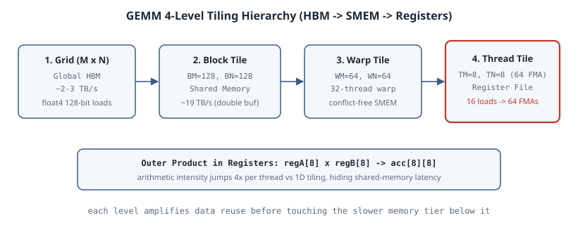

# GEMM Worklog II: Registers & Warp Tiling

Shared-memory tiling (Worklog I) slashes global HBM traffic by a factor of $B_K$, yet it stalls around 15–25% of peak FP32 throughput. The new bottleneck is **shared memory bandwidth itself**: if every thread computes only one output element $C_{i,j}$, each FMA instruction requires two shared-memory loads (`lds`), saturating the LSU pipe long before the FP32 ALU pipe is busy. Breaking through to >90% of cuBLAS speed requires two ideas: **2D register micro-tiling** (outer products in registers) and **128-bit vectorized loads (`float4`)**, organized into a 4-level warptiling hierarchy.



## Why 2D register tiling changes arithmetic intensity

Compare how many shared-memory loads a thread issues per FMA across three strategies:

| Tiling strategy | Accumulators / thread | SMEM loads per $k$-step | FMAs per $k$-step | FMAs per SMEM load |
| :--- | :---: | :---: | :---: | :---: |
| **Block-tiled only** ($1 \times 1$) | 1 | 2 | 1 | **0.5** |
| **1D register tile** ($8 \times 1$) | 8 | $8 + 1 = 9$ | 8 | **0.89** |
| **2D register tile** ($8 \times 8$) | 64 | $8 + 8 = 16$ | 64 | **4.0** |

Computing an $8 \times 8$ outer product in registers (`regA[8]` $\times$ `regB[8]` $\rightarrow$ `acc[8][8]`) boosts compute-to-SMEM-load ratio **8x** over naive block tiling. That single change shifts the inner loop from LSU-bound to FMA-bound.

## The four-level warptiling hierarchy

Production GEMM kernels (CUTLASS, cuBLAS, and Sibyl/Boehm's warptiled SGEMM) partition $C = A \times B$ into four nested levels:

1. **Grid tile ($M \times N$)**: Distributed across all SMs; one thread block owns a $B_M \times B_N$ output tile (e.g., $128 \times 128$).
2. **Block tile ($B_M \times B_N$, step $B_K$)**: Loaded cooperatively from HBM into double-buffered shared memory (`As[BK][BM]` transposed for conflict-free vector loads, `Bs[BK][BN]`).
3. **Warp tile ($W_M \times W_N$, e.g., $64 \times 64$)**: Each 32-thread warp owns a contiguous sub-region of the block tile so all 32 lanes hit separate shared memory banks with zero conflicts.
4. **Thread tile ($T_M \times T_N$, e.g., $8 \times 8$)**: Held entirely in per-thread registers (`float acc[8][8]`).

## Vectorized `float4` loads and transposed `As` in SMEM

Issuing four scalar `float` loads uses 4 instructions and 4 32-bit transactions; casting aligned pointers to `float4` issues **one 128-bit `LDG.E.128` instruction**:

```cuda
// Load 4 consecutive floats from global memory A into registers,
// then store transposed into shared memory As[k][m] so the inner loop
// can later issue conflict-free vectorized LDS.128 loads along m.
float4 tmp = reinterpret_cast<const float4*>(&A[row * K + col])[0];
As[(col + 0) * BM + row] = tmp.x;
As[(col + 1) * BM + row] = tmp.y;
As[(col + 2) * BM + row] = tmp.z;
As[(col + 3) * BM + row] = tmp.w;
```

## Core 2D register-tiled inner loop (CUDA)

```cuda
template <int BM, int BN, int BK, int TM, int TN>
__device__ void compute_register_tile(
    const float* __restrict__ As,  // [BK][BM] transposed
    const float* __restrict__ Bs,  // [BK][BN] row-major
    float (&acc)[TM][TN],
    int thread_row,
    int thread_col)
{
    float regM[TM];
    float regN[TN];

    #pragma unroll
    for (int dot = 0; dot < BK; ++dot) {
        // Vectorized loads from SMEM into thread-local registers
        #pragma unroll
        for (int i = 0; i < TM; ++i) {
            regM[i] = As[dot * BM + thread_row * TM + i];
        }
        #pragma unroll
        for (int j = 0; j < TN; ++j) {
            regN[j] = Bs[dot * BN + thread_col * TN + j];
        }
        // 64 independent FMAs — hides FMA pipeline latency via ILP
        #pragma unroll
        for (int i = 0; i < TM; ++i) {
            #pragma unroll
            for (int j = 0; j < TN; ++j) {
                acc[i][j] = fmaf(regM[i], regN[j], acc[i][j]);
            }
        }
    }
}
```

> [!TIP]
> **Double buffering (software pipelining)**
>
> Allocate two shared-memory buffers (`As[2][BK][BM]`, `Bs[2][BK][BN]`) and issue async global loads (`cp.async` on Ampere+) for tile `k + 1` while the register inner loop consumes tile `k`. This overlaps HBM latency completely behind FMA compute, bringing FP32 warptiled GEMM to ~93.7% of cuBLAS on Ampere GPUs.

## Hands-on lab: verify register-tile reuse and compile with `ptxas`

1. **CPU arithmetic-intensity verifier**: Run this short Python script to compare HBM bytes, SMEM loads, and FMA counts for $M=N=K=4096$ across block-tiled ($1\times 1$) vs warptiled ($8\times 8$):

```python
M = N = K = 4096
total_fmas = M * N * K
for name, tm, tn in [("Block-tiled 1x1", 1, 1), ("1D reg-tile 8x1", 8, 1), ("2D reg-tile 8x8", 8, 8)]:
    smem_loads_per_fma = (tm + tn) / (tm * tn)
    total_smem_gb = total_fmas * smem_loads_per_fma * 4 / 1e9
    print(f"{name:18s} | SMEM loads/FMA: {smem_loads_per_fma:.3f} | Total SMEM traffic: {total_smem_gb:7.1f} GB")
```

2. **On a CUDA GPU host**: Compile your warptiled kernel with `nvcc -O3 -arch=sm_80 --ptxas-options=-v warptile_gemm.cu` and verify **zero** `spill stores`/`spill loads` while keeping register usage $\le 128$ per thread so 2 blocks remain resident per SM.

## Summary

- 2D register micro-tiling ($8 \times 8$ outer products) cuts shared-memory load pressure by 8x compared to 1-element-per-thread block tiling.
- Transposing `As` in shared memory unlocks conflict-free `float4` (`LDS.128`) loads during the inner $k$-loop.
- Combining 4-level warptiling with `cp.async` double buffering reaches >93% of cuBLAS FP32 throughput.

## Sources

- [Simon Boehm — How to Optimize a CUDA Matmul Kernel for cuBLAS-like Performance](https://siboehm.com/articles/22/CUDA-MMM)
- [NVIDIA CUTLASS — Efficient GEMM in CUDA](https://github.com/NVIDIA/cutlass/blob/main/media/docs/efficient_gemm.md)
