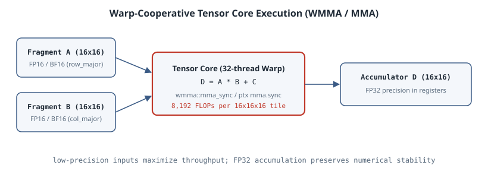

# Tensor Cores & WMMA: The Second Worklog

Starting with Volta, NVIDIA GPUs ship dedicated mixed-precision matrix engines called **Tensor Cores**. While a scalar FP32 CUDA core executes one FMA (2 FLOPs) per cycle, a warp-cooperative Tensor Core computes an entire $16 \times 16 \times 16$ matrix multiply-accumulate ($D = A \times B + C$, 8,192 FLOPs) in hardware — delivering 5–16x higher peak compute density on the same die.



## CUDA cores vs. Tensor Cores

| Property | FP32 CUDA Cores | Tensor Cores (WMMA / `mma.sync`) | Hopper `wgmma` |
| :--- | :--- | :--- | :--- |
| **Granularity** | 1 thread = 1 FMA (2 FLOPs) | 1 warp (32 threads) = $16 \times 16 \times 16$ | 1 warp group (128 threads) = $64 \times N \times 16$ |
| **Inputs** | FP32 | FP16, BF16, TF32, INT8 | FP16, BF16, FP8 |
| **Accumulator** | FP32 | FP32 (recommended) or FP16 | FP32 or FP16 |

## Shared-memory staged WMMA kernel

Staging $A$ and $B$ tiles through padded shared memory (`+8` halves = 16 bytes) eliminates bank conflicts before calling `wmma::load_matrix_sync` and `wmma::mma_sync`:

```cuda
#include <cuda_fp16.h>
#include <mma.h>
using namespace nvcuda;

__global__ void wmma_gemm_smem(const half* __restrict__ A, const half* __restrict__ B,
                               float* __restrict__ C, int M, int N, int K) {
    __shared__ half sA[16][24];
    __shared__ half sB[16][24];

    const int row = blockIdx.y * 16;
    const int col = blockIdx.x * 16;

    wmma::fragment<wmma::matrix_a, 16, 16, 16, half, wmma::row_major> a_frag;
    wmma::fragment<wmma::matrix_b, 16, 16, 16, half, wmma::row_major> b_frag;
    wmma::fragment<wmma::accumulator, 16, 16, 16, float> c_frag;
    wmma::fill_fragment(c_frag, 0.0f);

    for (int k = 0; k < K; k += 16) {
        for (int idx = threadIdx.x; idx < 256; idx += 32) {
            int r = idx / 16, c = idx % 16;
            sA[r][c] = (row + r < M && k + c < K) ? A[(row + r) * K + k + c] : __float2half(0.0f);
            sB[r][c] = (k + r < K && col + c < N) ? B[(k + r) * N + col + c] : __float2half(0.0f);
        }
        __syncthreads();
        wmma::load_matrix_sync(a_frag, &sA[0][0], 24);
        wmma::load_matrix_sync(b_frag, &sB[0][0], 24);
        wmma::mma_sync(c_frag, a_frag, b_frag, c_frag);
        __syncthreads();
    }
    if (row < M && col < N) {
        wmma::store_matrix_sync(C + row * N + col, c_frag, N, wmma::mem_row_major);
    }
}
```

## Hands-on lab: compare FP32 vs. FP16 accumulation accuracy on long K

```python
import torch

torch.manual_seed(0)
A = torch.randn(256, 4096, dtype=torch.float16) * 0.1
B = torch.randn(4096, 256, dtype=torch.float16) * 0.1
ref = A.double() @ B.double()
fp32_acc = A.float() @ B.float()
fp16_acc = torch.zeros(256, 256, dtype=torch.float16)
for k in range(0, 4096, 16):
    fp16_acc = fp16_acc + (A[:, k:k+16].float() @ B[k:k+16, :].float()).half()

print("FP32 acc rel L2:", ((fp32_acc.double() - ref).norm() / ref.norm()).item())
print("FP16 acc rel L2:", ((fp16_acc.double() - ref).norm() / ref.norm()).item())
```

## Summary

- Tensor Cores execute warp-cooperative $16 \times 16 \times 16$ MMAs with FP32 accumulation to preserve accuracy across long $K$ reductions.
- Drop down from `nvcuda::wmma` to PTX `ldmatrix` + `mma.sync` (or CuTe) when you need register-level epilogue fusion.
