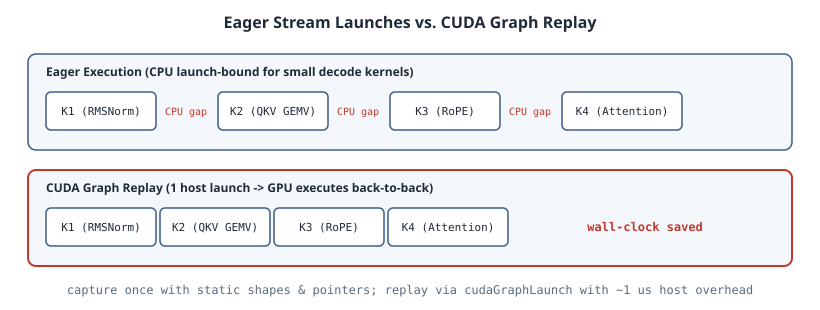

# CUDA Graphs — Capture and Replay

During LLM autoregressive decode (batch size 1–16), individual kernels like RMSNorm, RoPE, and small GEMVs execute in **3–10 microseconds** on an H100 — faster than the Python interpreter and CUDA driver take to enqueue the next launch (~5–15 microseconds). The result is a GPU timeline full of idle gaps where the silicon sits waiting for the CPU. **CUDA Graphs** eliminate this bottleneck by recording an entire DAG of kernel launches once and replaying it with a single ~1-microsecond host call.



## The three-phase graph lifecycle

1. **Capture** (`cudaStreamBeginCapture` → launch kernels on non-default stream → `cudaStreamEndCapture`): Records every kernel node, memory copy, and dependency edge into a `cudaGraph_t` without executing them.
2. **Instantiate** (`cudaGraphInstantiate`): Validates the graph, pre-allocates driver launch descriptors, and uploads the executable command buffer (`cudaGraphExec_t`) to the GPU.
3. **Replay** (`cudaGraphLaunch`): Submits the entire pre-baked DAG in one driver call — zero per-kernel Python/C++ dispatch overhead.

## C++ CUDA Stream Capture example

```cuda
#include <cuda_runtime.h>

void run_with_cuda_graph(cudaStream_t stream, float* d_x, float* d_y, int n) {
    cudaGraph_t graph = nullptr;
    cudaGraphExec_t graph_exec = nullptr;

    // 1. Warm up once outside capture (initializes cuBLAS/allocator caches)
    rmsnorm_kernel<<<n / 256, 256, 0, stream>>>(d_x, d_y, n);
    cudaStreamSynchronize(stream);

    // 2. Capture the sequence of kernels on a non-default stream
    cudaStreamBeginCapture(stream, cudaStreamCaptureModeGlobal);
    rmsnorm_kernel<<<n / 256, 256, 0, stream>>>(d_x, d_y, n);
    silu_kernel<<<n / 256, 256, 0, stream>>>(d_y, d_x, n);
    cudaStreamEndCapture(stream, &graph);

    // 3. Instantiate once
    cudaGraphInstantiate(&graph_exec, graph, nullptr, nullptr, 0);

    // 4. Replay 1,000 times with a single host launch per iteration
    for (int step = 0; step < 1000; ++step) {
        cudaGraphLaunch(graph_exec, stream);
    }
    cudaStreamSynchronize(stream);

    cudaGraphExecDestroy(graph_exec);
    cudaGraphDestroy(graph);
}
```

## PyTorch CUDA Graphs for LLM inference (static-buffer pattern)

Because a captured graph hardcodes **exact GPU memory addresses and tensor shapes**, PyTorch code must copy new inputs into static pre-allocated buffers before calling `graph.replay()`:

```python
import torch

# Pre-allocate static input/output buffers on GPU
static_x = torch.empty(1, 4096, device="cuda", dtype=torch.bfloat16)
static_w = torch.randn(4096, 4096, device="cuda", dtype=torch.bfloat16)

# 1. Warmup on a side stream (mandatory before capture)
s = torch.cuda.Stream()
s.wait_stream(torch.cuda.current_stream())
with torch.cuda.stream(s):
    for _ in range(3):
        static_y = torch.nn.functional.silu(static_x @ static_w)
torch.cuda.current_stream().wait_stream(s)

# 2. Capture
g = torch.cuda.CUDAGraph()
with torch.cuda.graph(g):
    static_y = torch.nn.functional.silu(static_x @ static_w)

# 3. Replay on new data by copying into static_x in-place
new_input = torch.randn_like(static_x)
static_x.copy_(new_input)
g.replay()
result = static_y.clone()
```

> [!WARNING]
> **What breaks CUDA Graph capture**
>
> - **Host-device synchronization**: Calling `tensor.item()`, `print(tensor)`, or `cudaDeviceSynchronize()` inside capture aborts immediately.
> - **Dynamic memory allocation / dynamic shapes**: Changing sequence length or batch size requires either bucketing (vLLM captures separate graphs for batch sizes `[1, 2, 4, 8, 16, 32, 64]`) or updating node parameters via `cudaGraphExecKernelNodeSetParams`.
> - **Capturing on the legacy default stream (`stream 0`)**: Always capture on a dedicated non-default stream.

## Hands-on lab: measure eager vs. CUDA Graph launch overhead in PyTorch

Run this microbenchmark on any CUDA GPU to quantify the exact speedup on small-kernel chains (the decode regime):

```python
import time
import torch

assert torch.cuda.is_available(), "Run on a CUDA GPU host"

N = 2048
x = torch.randn(1, N, device="cuda", dtype=torch.float16)
w = torch.randn(N, N, device="cuda", dtype=torch.float16)

def chain(inp):
    h = inp
    for _ in range(20):
        h = torch.relu(h + 0.01)
    return h

# Eager timing
for _ in range(10):
    _ = chain(x)
torch.cuda.synchronize()
t0 = time.perf_counter()
for _ in range(500):
    out_eager = chain(x)
torch.cuda.synchronize()
eager_us = (time.perf_counter() - t0) * 1e6 / 500

# CUDA Graph capture + replay timing
static_x = x.clone()
g = torch.cuda.CUDAGraph()
with torch.cuda.graph(g):
    static_out = chain(static_x)
torch.cuda.synchronize()
t0 = time.perf_counter()
for _ in range(500):
    g.replay()
torch.cuda.synchronize()
graph_us = (time.perf_counter() - t0) * 1e6 / 500

print(f"Eager 20-kernel chain : {eager_us:6.1f} us")
print(f"CUDA Graph replay     : {graph_us:6.1f} us  ({eager_us / graph_us:.2f}x faster)")
```

## Summary

- CUDA Graphs collapse dozens of tiny CPU kernel launches into a single GPU-side replay, eliminating idle bubbles during LLM decode.
- Always warm up on a side stream before capture, avoid host syncs inside capture, and copy new inputs into static buffers before `g.replay()`.
- In production serving (vLLM, SGLang, TensorRT-LLM), capture a fixed ladder of batch-size buckets and pad incoming decode batches to the next bucket.

## Sources

- [CUDA C++ Programming Guide — CUDA Graphs](https://docs.nvidia.com/cuda/cuda-c-programming-guide/index.html#cuda-graphs)
- [PyTorch Accelerating with CUDA Graphs](https://pytorch.org/blog/accelerating-pytorch-with-cuda-graphs/)
