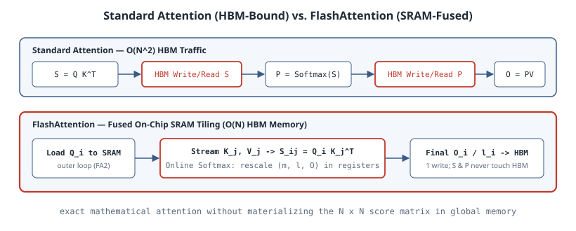

# Attention: The Kernel That Ate the World & FlashAttention v1

Standard scaled dot-product attention computes:

$$\text{Attention}(Q, K, V) = \text{Softmax}\left(\frac{Q K^T}{\sqrt{d_k}}\right) V$$

For sequence length $N$ and head dimension $d$ ($N \gg d$), naive PyTorch attention materializes the full $N \times N$ score matrix $S = QK^T / \sqrt{d_k}$ and probability matrix $P = \text{Softmax}(S)$ in global HBM memory. At $N = 32,768$ in FP16 with 32 heads, a single $S$ matrix consumes **64 GB** of HBM and spends >90% of wall-clock time shuttling bytes back and forth instead of running Tensor Cores.



## The breakthrough: tiling + online softmax

**FlashAttention** (Dao et al., 2022) computes *mathematically exact* attention with **$O(N)$ HBM memory** by never writing $S$ or $P$ to HBM. Instead, it streams blocks $Q_i \in \mathbb{R}^{B_r \times d}$ and $K_j, V_j \in \mathbb{R}^{B_c \times d}$ into fast on-chip SRAM (~19 TB/s vs. ~2–3 TB/s HBM) and updates the softmax denominator incrementally via **online softmax**.

For each incoming key/value block $j$ with local scores $S_{ij} = Q_i K_j^T / \sqrt{d}$:

$$m_{\text{new}} = \max(m_{\text{prev}}, \text{rowmax}(S_{ij}))$$

$$\tilde{P}_{ij} = \exp(S_{ij} - m_{\text{new}}), \qquad \alpha = \exp(m_{\text{prev}} - m_{\text{new}})$$

$$l_{\text{new}} = \alpha \, l_{\text{prev}} + \text{rowsum}(\tilde{P}_{ij}), \qquad \tilde{O}_{\text{new}} = \alpha \, \tilde{O}_{\text{prev}} + \tilde{P}_{ij} V_j$$

At the very end of the $j$-loop, divide once: $O_i = \tilde{O}_i / l_i$.

## Hands-on lab: runnable FlashAttention v1 in Python/PyTorch (verifying exact equivalence)

Run this self-contained tiled FlashAttention reference implementation on CPU or GPU and verify that its output matches naive $O(N^2)$ attention to machine precision:

```python
import math
import torch

def flash_attention_v1_ref(Q: torch.Tensor, K: torch.Tensor, V: torch.Tensor,
                           Br: int = 32, Bc: int = 32) -> torch.Tensor:
    """Exact tiled FlashAttention forward pass using online softmax."""
    N, d = Q.shape
    scale = 1.0 / math.sqrt(d)
    O = torch.zeros_like(Q, dtype=torch.float32)

    for i in range(0, N, Br):
        Qi = Q[i:i+Br].float()                     # [Br, d]
        rows = Qi.shape[0]
        m = torch.full((rows, 1), -float("inf"))   # running row max
        l = torch.zeros((rows, 1))                 # running exp sum
        acc = torch.zeros((rows, d))               # unnormalized output

        for j in range(0, N, Bc):
            Kj = K[j:j+Bc].float()                 # [Bc, d]
            Vj = V[j:j+Bc].float()                 # [Bc, d]
            Sij = (Qi @ Kj.T) * scale              # [Br, Bc] in "SRAM"

            m_block = Sij.max(dim=-1, keepdim=True).values
            m_new = torch.maximum(m, m_block)
            alpha = torch.exp(m - m_new)
            P_tilde = torch.exp(Sij - m_new)

            l = alpha * l + P_tilde.sum(dim=-1, keepdim=True)
            acc = alpha * acc + P_tilde @ Vj
            m = m_new

        O[i:i+Br] = acc / l
    return O.to(Q.dtype)

torch.manual_seed(42)
Q, K, V = [torch.randn(256, 64) for _ in range(3)]
naive = torch.softmax((Q @ K.T) / math.sqrt(64), dim=-1) @ V
flash = flash_attention_v1_ref(Q, K, V, Br=32, Bc=32)
print("Max absolute error vs naive attention:", (naive - flash).abs().max().item())
```

Expect a max absolute error around `~1e-6`, proving tiled online softmax is **exact** (not an approximation) while eliminating all $O(N^2)$ intermediate HBM traffic.

## Summary

- Naive attention is strictly HBM-bandwidth bound because it writes and re-reads $N \times N$ matrices $S$ and $P$.
- FlashAttention keeps $S_{ij}$ and $\tilde{P}_{ij}$ strictly inside on-chip SRAM/registers and uses online softmax rescaling $(\alpha, m, l)$ to accumulate exact outputs in a single pass.

## Sources

- [Dao et al., FlashAttention: Fast and Memory-Efficient Exact Attention with IO-Awareness (NeurIPS 2022)](https://arxiv.org/abs/2205.14135)
