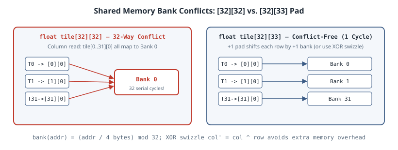

# Shared Memory Bank Conflicts

## Thesis

On NVIDIA GPUs, **shared memory** is striped into **32 four-byte banks** (`bank = (byte_addr / 4) % 32`). When threads in a warp hit the **same bank** with different addresses, accesses serialize into $k$-way **bank conflicts**. Inner-dimension padding (`+1`) or **XOR swizzling** (`col ^ row`) removes conflicts without changing algorithms.



## Mental model

```text
  32 banks (typical modern NVIDIA)
  address → bank = (addr / 4 bytes) % 32

  conflict-free: thread t reads bank t
  2-way conflict: two threads → same bank → two serial steps
```

## Worked example

Classic transpose pad (CUDA teaching pattern — docs/sim; no GPU install on this box):

```cuda
// Without pad: column read after row write → 32-way conflicts
__shared__ float tile[32][32];

// With pad: +1 column shifts banks for the transpose read
__shared__ float tile[32][33];
```

Row-write `tile[ty][tx] = …` then column-read `… = tile[tx][ty]` conflicts hard on `[32][32]`; `[32][33]` makes successive `ty` land on different banks.

Nsight Compute metrics: `l1tex__data_bank_conflicts_pipe_lsu_mem_shared_op_ld.sum` (names vary by toolkit) — drive to zero for the hot kernel.

## Trap

**Padding blindly on every buffer.** Extra shared memory can cut occupancy. Measure: conflict-free + lower occupancy can lose to mild conflicts + more resident blocks. Also: 8-byte types change bank mapping — think in 32-bit bank words.

## Boring rule

For 32-wide tiles, try `+1` pad on the inner dimension; verify with a profiler bank-conflict counter; keep the pad only if the kernel gets faster.

## Try this

1. Microbench `[32][32]` vs `[32][33]` transpose.
2. Read the CUDA C++ Programming Guide shared-memory section for your arch.
3. Compare XOR-swizzle addressing vs padding.

## Sources

- CUDA C++ Programming Guide — shared memory / bank conflicts
- Nsight Compute metrics reference
- NVIDIA teaching materials on transpose optimisation
