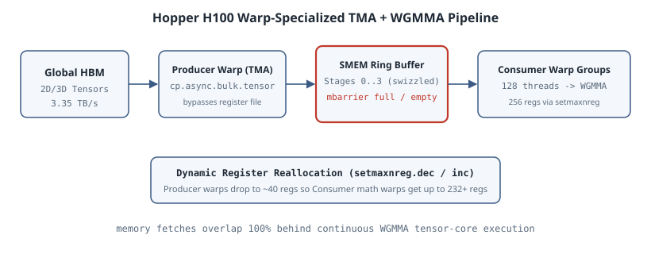

# Beating cuBLAS on an H100

On NVIDIA Hopper (H100, SM90), saturating **989 TFLOP/s** (BF16) or **1,979 TFLOP/s** (FP8) requires abandoning the synchronous Ampere loop (`load -> __syncthreads() -> mma -> repeat`). Hopper's Tensor Cores run so fast that any cycle spent calculating tile addresses or waiting at a block-wide barrier shows up immediately as lost throughput. Beating cuBLAS on H100 comes down to four tightly coordinated hardware features: **TMA**, **WGMMA**, **Warp Specialization**, and **Persistent Thread Blocks with L2 Swizzling**.



## 1. Tensor Memory Accelerator (TMA)

On Ampere, every thread had to compute global addresses, check boundary predicates, issue `cp.async`, and consume registers. On Hopper, **one single thread** in a producer warp issues a hardware-accelerated 2D/3D/5D tensor copy (`cp.async.bulk.tensor`) using a pre-built `CUtensorMap` descriptor:
- Hardware handles out-of-bounds zero padding automatically.
- Hardware applies shared-memory **128B/64B swizzling** on the fly during the copy (zero bank conflicts for WGMMA).
- The copy bypasses the register file completely and signals an asynchronous `mbarrier` upon completion.

## 2. Warp Specialization & Dynamic Register Reallocation

Instead of every warp alternating between memory loads and math, a 384-thread Hopper CTA splits into distinct roles:

| Role | Thread count | Register budget (`setmaxnreg`) | Responsibility |
| :--- | :---: | :---: | :--- |
| **Producer Warp Group** | 128 (or 1–2 warps) | ~40 regs/thread (`setmaxnreg.dec`) | Issues TMA loads into a 3–5 stage SMEM ring buffer |
| **Consumer Warp Group 0** | 128 threads | ~232 regs/thread (`setmaxnreg.inc`) | Issues `wgmma.mma_async` directly from SMEM descriptors |
| **Consumer Warp Group 1** | 128 threads | ~232 regs/thread (`setmaxnreg.inc`) | Overlaps epilogue / second output tile in parallel |

## 3. Persistent Kernels + L2 Cache Swizzling (Hilbert / Grouped Tile Order)

Launching one block per output tile creates wave quantization tails whenever the tile count is not a multiple of 132 (H100 SM count). A **persistent kernel** launches exactly 132 CTAs (one per SM) that loop over output tiles in **L2-swizzled groups** (e.g., `GROUP_M = 8`) so adjacent SMs reuse the same $A$ and $B$ slabs in H100's 50 MB L2 cache.

```cuda
// L2-friendly grouped tile scheduling (Triton / CUDA persistent loop)
__device__ void swizzled_tile_coords(int tile_id, int grid_m, int grid_n,
                                     int group_m, int& out_m, int& out_n) {
    int tiles_per_group = group_m * grid_n;
    int group_id = tile_id / tiles_per_group;
    int first_m = group_id * group_m;
    int actual_group_m = min(grid_m - first_m, group_m);
    out_m = first_m + (tile_id % actual_group_m);
    out_n = (tile_id % tiles_per_group) / actual_group_m;
}
```

## Hands-on lab: quantify L2 cache reuse of row-major vs. swizzled tile scheduling

```python
def unique_ab_tiles(grid_m: int, grid_n: int, window: int = 132, group_m: int = 8):
    # Row-major launch order for the first `window` SMs
    rm_a = {t // grid_n for t in range(window)}
    rm_b = {t % grid_n for t in range(window)}

    # Swizzled GROUP_M=8 launch order
    sw_a, sw_b = set(), set()
    for t in range(window):
        tpg = group_m * grid_n
        gid = t // tpg
        fm = gid * group_m
        gm = min(grid_m - fm, group_m)
        sw_a.add(fm + (t % gm))
        sw_b.add((t % tpg) // gm)

    print(f"Row-major  (132 SMs): {len(rm_a):3d} A tiles + {len(rm_b):3d} B tiles = {len(rm_a)+len(rm_b)} HBM fetches")
    print(f"Swizzled M={group_m} (132 SMs): {len(sw_a):3d} A tiles + {len(sw_b):3d} B tiles = {len(sw_a)+len(sw_b)} HBM fetches")

unique_ab_tiles(grid_m=64, grid_n=64)
```

Notice how swizzling slashes simultaneous unique $A + B$ HBM tile fetches dramatically, keeping the working set inside H100's L2 cache.

## Summary

- Matching or beating cuBLAS on H100 combines TMA async swizzled loads, warp specialization with `setmaxnreg`, multi-stage `mbarrier` ring buffers, and L2-swizzled persistent scheduling.

## Sources

- [Pranjal Shankhdhar — Outperforming cuBLAS on H100: a Worklog](https://cudaforfun.substack.com/)
- [NVIDIA CUTLASS 3.x Hopper GEMM Documentation](https://github.com/NVIDIA/cutlass/tree/main/examples/48_hopper_warp_specialized_gemm)
