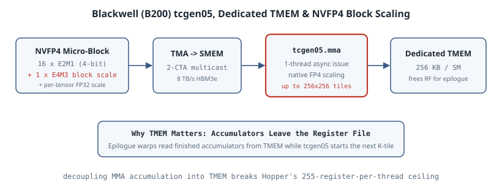

# Blackwell & NVFP4

NVIDIA's **Blackwell (B200 / GB200, SM100)** redesigns the SM around three bottlenecks that capped Hopper (H100): register-file pressure from large accumulators, 128-thread warp-group MMA coordination, and coarse per-tensor quantization error.



## Hopper (SM90) vs. Blackwell (SM100)

| Feature | Hopper (H100) | Blackwell (B200) | Impact |
| :--- | :--- | :--- | :--- |
| **MMA Issue** | `wgmma` (128-thread warp group) | **`tcgen05.mma`** (1-thread async, 2-CTA cooperative) | Frees warps; scales to $256 \times 256$ tiles |
| **Accumulators** | Register File (255 regs/thread cap) | **Dedicated Tensor Memory (TMEM, 256 KB/SM)** | Epilogue & Softmax run with zero RF spills |
| **4-bit Format** | Software INT4 dequant | **Hardware NVFP4** (16x E2M1 + E4M3 block scale) | 4.5 bits/param, ~2x FP8 throughput |

## Hands-on lab: simulate NVFP4 16-element block quantization in Python

```python
import torch

E2M1 = torch.tensor([0.0, 0.5, 1.0, 1.5, 2.0, 3.0, 4.0, 6.0])

def nvfp4_roundtrip(x: torch.Tensor, block_size: int = 16) -> torch.Tensor:
    b = x.float().reshape(-1, block_size)
    scale = (b.abs().amax(dim=-1, keepdim=True).clamp(min=1e-8) / 6.0).to(torch.float8_e4m3fn).float()
    scaled = b / scale.clamp(min=1e-8)
    idx = (scaled.abs().unsqueeze(-1) - E2M1).abs().argmin(dim=-1)
    return (torch.sign(scaled) * E2M1[idx] * scale).reshape(x.shape)

x = torch.randn(64, 128)
x[:, 0] *= 15.0  # Outlier channel
print("NVFP4 rel L2 error:", ((x - nvfp4_roundtrip(x)).norm() / x.norm()).item())
```

## Summary

- `tcgen05.mma` + dedicated 256 KB **TMEM** remove Hopper's register-file ceiling; **NVFP4** fuses 16-element E2M1 micro-block scaling directly in Tensor Core hardware.

## Sources

- [NVIDIA Blackwell Architecture Technical Brief](https://resources.nvidia.com/en-us-blackwell-architecture)
